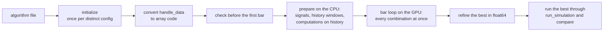

# How a sweep works

This page explains what happens between `ziplime sweep run` and the results table: why an ordinary
`handle_data` can run on a GPU, what is computed where, and how the sweep makes sure its numbers
are the engine's. For running a sweep, see [Parameter sweeps](parameter-sweeps.md); for speed, see
[Sweep performance](sweep-performance.md).

## The principle: combinations in parallel, bars in order

A backtest cannot be parallelised over time: what a strategy does at bar *t* depends on the
portfolio after bar *t − 1*. A sweep does not try. It parallelises over **combinations**: every
value in the strategy becomes an array with one row per combination and one column per
instrument, and each bar is one step over the whole array. Bars still go one at a time, in the
engine's order — dividends and splits at the session start, `before_trading_start`, marks synced
to the close, fills, `handle_data`, scheduled functions, the session end with auto-close and the
cancel policy.



## Converting `handle_data`

`handle_data` cannot run on a GPU as written: every combination executes the same instructions,
while an `if` takes a different branch in each. The sweep reads the function's source and rewrites
it — as TensorFlow's AutoGraph does — into array code that runs every combination at once:

| In the strategy | In the sweep |
|---|---|
| `for name, asset in context.universe.items()` | one pass over every instrument |
| `context.signals["fast"][name]` | an array (combinations × instruments) |
| `if a > b: A else: B` | both branches run, each under its own mask |
| `x = ...` inside an `if` | changes only where the mask holds |
| `continue`, `return`, `return value` | the mask switches the rest off for those lanes |
| `and`, `or`, `not`, `x if c else y`, `a < b < c` | elementwise |
| `math.isnan`, `min`, `max`, `abs`, `int`, `float`, `all`, `any` | elementwise |
| `np.log`, `np.where`, `np.clip`, `np.sqrt` and the other elementwise NumPy functions | the same functions of MLX or CuPy |
| `np.mean([a, b, c])`, `np.std`, `np.max`, `np.nanmean` over a list | reduce the list, value by value |
| `name == "SBER"` in the loop | a mask over the instruments |
| `context.entry = {}`, then `context.entry[name] = price`, `del`, `in`, `.get`, `.items()` | a dict keyed by instrument: an array of values and one of which are present |
| `scores = {}` filled in the loop, `{n: ... for n in context.universe}` | the same, local to the bar |
| `sorted(scores, key=scores.get, reverse=True)[:k]`, `max(scores, key=...)` | each instrument's place within its combination; `[:k]` a mask, `k` may be swept |
| `name in best`, `len(best)`, `for name in best` | per combination |
| `sum(d.values())`, `any(s != s for s in d.values())`, `sum(w[n] for n in best)` | reduced across the instruments of each combination |
| a function of the strategy's own modules called from `handle_data`, a function defined inside it | converted the same way |
| `cands = ["SOXL", "TQQQ"]`, `cands.sort(key=...)`, `cands[:2]`, `[assets[s] for s in cands[:2]]`, a list assigned differently in each branch | a list of instruments per combination: `in`, `len`, `if lst` per combination |
| `p = data.history(...)["close"].to_numpy()`, then `p[-n:]`, `np.diff`, `np.std`, `np.maximum.accumulate`, `talib.RSI(p, ...)`, `p.mean()` | recorded, and computed on the CPU before the run (see below) |
| `context.model.predict_proba(features)` for a model fitted in `initialize` | the same |
| `context.i += 1` | a plain number: the same for every combination |

`initialize` is not converted: it runs as Python, once per distinct set of the config fields it
reads — a million combinations of a strategy whose `initialize` reads two fields cost a few
hundred calls.

## Checked before the first bar

Everything the strategy calls on `context`, `data` and `context.portfolio`, and every call into
another library, is checked against what the sweep simulates before anything is computed. A sweep
never produces numbers that may differ from the engine's: what it cannot simulate is reported with
its file and line, all at once.

## What a sweep simulates

Everything below matches run_simulation to the cent; the test suite (`tests/sweep`) runs each item
against the engine combination by combination.

* `order`, `order_value`, `order_percent`, `order_target`, `order_target_value`,
  `order_target_percent`, longs and shorts, with the engine's sizing (projected commission, the
  slippage model's volume cap)
* market, limit, stop and stop-limit orders; `get_open_orders`; `set_cancel_policy` with
  `NeverCancel` or `EODCancel`; up to 4 open orders per instrument at once
* commissions `per_share`, `per_dollar`, `per_trade`, `per_contract` (with the per-order minimum and
  exchange fee); slippage `none`, `fixed_bps` (with partial fills against the bar's volume),
  `fixed_spread`; `set_commission` / `set_slippage` in `initialize`
* `data.current`, `data.history(assets=[asset], bar_count=n, fields=[...])` with `.mean()`,
  `.sum()`, `.std()`, `.var()`, `.min()`, `.max()`, `.median()`, `.first()`, `.last()`, `.count()`,
  `data.returns`, `data.can_trade`; missing bars read the previous row, as in the engine
* `data.history` over several instruments in one call (`assets=list(context.universe.values())`):
  the engine's long frame, read per instrument —
  `frame.filter(pl.col("sid") == asset.sid)["close"].mean()`, or
  `frame.group_by("sid").agg(pl.col("close").last() / pl.col("close").first() - 1, ...)` with any
  of the statistics above, `.alias(...)` and arithmetic, read through `iter_rows(named=True)` or
  `iter_rows()`; `frame.is_empty()`. `frame["close"]` of the whole frame mixes the instruments'
  rows and is refused
* `context.rebalance(weights)`: named instruments to their weights, the rest closed
* `context.datasets` (fundamentals, filings), as of every bar: through `prices.dataset(...)` in
  compute_signals, or as columns `"label.field"` in `context.indicators`
* intraday runs (`"emission_rate": "1m"`, `"5m"`, `"1h"` on a bundle of that frequency): bars from
  the session's first minute every rate, `before_trading_start` once a session reading the
  previous close, time rules of `schedule_function` (`market_open(minutes=30)`), `data.history`
  in days built from the bars — today's partial one included — or in the run's own bars,
  EODCancel at the session's end, the portfolio's value per session
* `context.portfolio.cash`, `.portfolio_value`, `.positions_value`, `.positions_exposure`,
  `get_asset_positions_amount`; `portfolio.positions.get(asset)`, `positions[asset].amount`,
  `asset in positions`, `len(positions)`, `positions.get(asset) is None`
* `context.symbol(...)` in `handle_data`; when `initialize` declares no instruments, the universe
  is the tickers `handle_data` looks up (constants, or a list of them it loops over)
* `before_trading_start`, `schedule_function` with any date rule (the rule may depend on the config)
* cash dividends and splits from the asset database, auto-close past an instrument's last bar or
  auto-close date
* futures: multiplier, daily settlement, per-contract commission

Not converted: `data.history(since=...)` and event datasets read through `data_source`, polars
beyond `pl.col` in the converted hooks, continuous futures and rolls, options and bonds,
`cancel_order`, account and trading controls.

## Computations on history

A strategy often reads history as an array and computes on it with whatever it likes — slices,
NumPy, TA-Lib, SciPy, a fitted model. None of that runs on a GPU, and it does not have to: it reads
history and numbers, not the portfolio, so at every bar it is the same in every combination that
agrees on those numbers.

In a sweep `.to_numpy()` (or any other method of the engine's polars Series) gives a **record** of
what is done to the rows, nothing computed. Where a number is needed — a comparison, a branch, a
ranking, an order — the sweep notes the record, and before the run replays it on the CPU with the
real rows and the real libraries at every bar, once per distinct value of what it reads from the
config (`p[-config.window:]`, `timeperiod=config.period`). At every bar the step then reads the
number like a history window. The record has to end in a number: index, slice or reduce it.

```python
async def handle_data(context, data):
    config = context.algorithm.config
    p = (await data.history(assets=[asset], bar_count=250, fields=["close"]))["close"].to_numpy()
    rets = np.diff(p[-config.window:]) / p[-config.window:-1]
    if np.std(rets) * 100 <= config.limit and talib.RSI(p, timeperiod=14)[-1] < 30:
        ...
```

Three ways a record is computed, from fastest:

1. **Once on the whole history.** A TA-Lib function whose last value reads only the window's last
   points — ROC, MOM, SMA, WMA, TRIMA, SUM, MAX, MIN, MIDPOINT, STDDEV, VAR, LINEARREG and its
   variants, TSF, WILLR, CCI, AROON, AROONOSC, MFI, ULTOSC, CORREL, BETA, MIDPRICE, TRANGE, the
   price averages, and BBANDS, STOCH, STOCHF with the simple moving average (`lazy.WINDOW_LOCAL`) —
   in `talib.X(history[-k:], ...)[-1]`, `talib.X(high, low, close)[j][-1]` or a row of the window
   by index (`p[-1] / p[0] - 1`), alone or in arithmetic, runs once over each instrument's history
   and is read at every bar's last row. The test suite checks every function on the list against
   the window it replaces.
2. **Bar by bar.** Anything else — the smoothed indicators (EMA, RSI, MACD, ATR, ADX) depend on
   where the window begins, `np.std` of returns, a drawdown through `np.maximum.accumulate` — is
   replayed at every bar.
3. **Bar by bar on the CPU's cores.** Past two million evaluations the replay is spread over
   processes (`ZIPLIME_SWEEP_REPLAY_WORKERS` sets how many). The script that starts the sweep then
   needs `if __name__ == "__main__":`, as with `backend: cpu`.

**Models.** An object `initialize` keeps on `context` — a fitted scikit-learn model, a scaler —
predicts from features computed on history the same way: `context.model.predict_proba(features)`
is a record. When `initialize` fits it with config values (`C=config.strength`), each distinct value
is its own model and each combination reads its own, so a sweep over a model's hyperparameters
fits each model once. Methods that change the object during the run (`fit`, `partial_fit`,
`set_params`) are refused.

## Compiling the step

With MLX each bar's step is compiled with `mx.compile` into a few GPU kernels, and 16 bars are
joined into one call, so Python runs once per 16 bars. MLX keeps the compiled kernels between runs
(in `/tmp/mlx` on Linux), so only the first run of a strategy on a machine pays for compiling.
CuPy runs every operation as its own kernel.

A record whose value depends on the config is compiled too: each combination's row of the
record's values is found once per batch, from the values the first bar reads, and the compiled step
only checks — one comparison per combination — that the value is still the same. A value that
changes during the run (one that depends on the portfolio) fails the check, and the batch runs again
without compiling, checking every bar on the host.

The bars are not compiled when the strategy keeps non-numeric state on `context` or reads the date;
the report printed with the results says why.

## Precision and verification

GPUs compute in float32. When decisions depend on the portfolio's value, one share's rounding can
change a combination's path, so:

1. the top `refine_top` combinations (50 by default) are recomputed on the CPU in float64 before the
   final ranking;
2. the best one is run again in float64 with every fill recorded (`best_fills.csv`);
3. with `verify` (the default), the best one is run through run_simulation and its trades compared
   with the sweep's — the line `trades agree: yes; largest portfolio value gap: $0.00`.

## When a strategy cannot be converted

It is still swept: every combination goes through run_simulation, the combinations spread over the
CPU's cores (`workers`), and the sweep says why. These are the engine's own numbers, only as slow as
the engine; `"on_unsupported": "refuse"` (or `--refuse`) stops instead.

Libraries called on what differs between combinations — signals, the portfolio, config values —
cannot be converted: pandas, polars beyond `pl.col`, a NumPy function with no elementwise
counterpart (`np.cumsum` of a signal), a NumPy reduction with an `axis`. Such code computes on the
CPU number by number; handed an array of a hundred thousand combinations it would fail or quietly
compute something else. If it computes from price history, read the history as an array (above),
or compute it in `compute_signals` or `context.indicators` and read the result from
`context.signals`. What needs the portfolio at every bar cannot be swept.

What else the conversion cannot do, also named with the line:

* a loop over instruments that carries a value from one instrument to the next (`budget -= ...`):
  every instrument is processed at once
* `break`, `while`, `raise` or `assert` on a value that differs between combinations
* `try`, `with`, classes and generators inside a converted function

## Where the code is

| Module (`ziplime/sweep/`) | What it does |
|---|---|
| `runner.py` | the order of work: grid, initialize, conversion, batches, refine, verification |
| `convert.py` | rewriting `handle_data` into array code; NumPy, math, polars and other libraries inside it |
| `engine.py` | one bar's step on arrays: orders, fills, costs, splits, dividends, futures, compiling |
| `api.py` | `context`, `data` and the portfolio as arrays |
| `cross.py` | instruments compared with each other: sorting, top-k, lists of instruments |
| `frames.py` | `data.history` over several instruments |
| `lazy.py` | computations on history rows and models, replayed on the CPU |
| `backends.py` | MLX, CuPy and NumPy behind one interface |
| `check.py` | what the strategy uses, checked before the first bar |
| `explain.py` | the report and the warnings printed with the results |
| `fallback.py` | every combination through run_simulation, for what cannot be converted |
| `simulation.py` | `sweep_simulation`, with run_simulation's arguments |
| `tools.py` | `ziplime sweep init`, `check`, `doctor` |
| `market.py`, `signals.py`, `data.py`, `initialize.py`, `params.py`, `report.py` | bars, signals, data loading, initialize, the sweep file, the results |
